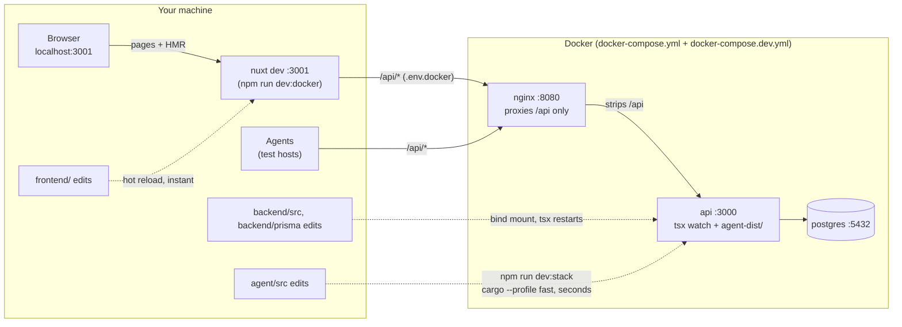

# Monli

Self-hosted metric monitoring system. See [PROJECT_PLAN.md](./PROJECT_PLAN.md)
for the full design (data model, policy resolution, agent design, API).

## Layout

- `backend/` — Node.js + TypeScript + Express API server (Postgres via Prisma).
- `frontend/` — Vue 3 + Nuxt UI admin SPA, built into the nginx image.
- `agent/` — Rust metric-collecting agent.
- `nginx/` — serves the frontend and proxies `/api/*` to the API (prefix stripped).

## Quick start (Docker)

```
cp .env.example .env          # set POSTGRES_PASSWORD and BETTER_AUTH_SECRET
docker compose up -d --build
curl http://localhost:8080/api/health
```

This starts Postgres, the API, and nginx. Migrations run automatically when
the API container starts. The UI is at `http://localhost:8080` and the API at
`http://localhost:8080/api` (change the port with `HTTP_PORT` in `.env`).

For a real deployment, set `PUBLIC_API_URL` to the address your monitored
hosts can reach, including the `/api` prefix — it's embedded in the agent
install command.

## Signing in

The first start creates an admin account:

- Email: `admin@monli.local`
- Password: `monliadmin`

Change this password after the first sign-in (user menu → Change password):
anyone who has read this README knows it. The account is only created while
there are no users, so deleting it later doesn't bring it back.

Admins create everyone else under Setup → Users and give each user a role:

| Role   | Can                                                      |
|--------|----------------------------------------------------------|
| viewer | see every page; no actions                               |
| editor | everything except managing users                         |
| admin  | everything, including creating, changing and removing users |

There is no self sign-up. Agents don't use these accounts: they authenticate
with their own enrollment token and API key.

## Local development (backend outside Docker)

```
cp .env.example .env
docker compose up -d postgres   # just the database
npm install
cp backend/.env.example backend/.env
npm run prisma:migrate --workspace backend
npm run dev --workspace backend # http://localhost:3000
npm run dev --workspace frontend # http://localhost:3001, proxies /api to :3000
```

## Fast dev loop (Docker)

```
npm run dev        # builds/starts postgres + api + nginx, then the UI on :3001
npm run dev:logs   # follow the API's logs (second terminal)
npm run dev:down   # stop the Docker stack
```

Ctrl+C stops only the UI; the Docker stack keeps running until `dev:down`.



- Backend edits under `backend/src` reload automatically (`tsx watch`), with no rebuild.
- Frontend edits hot-reload in the browser.
- Agent edits: rerun `npm run dev` (or just `npm run dev:stack`). Dev builds the agents
  with the `fast` cargo profile (no LTO), so this takes seconds instead of minutes.
- Prisma schema edits: rerun `npm run dev:stack`; the API regenerates the client and
  applies migrations on start.
- In dev, `:8080` serves only `/api` (agents still go through nginx); the UI is on `:3001`.

## Running tests

```sh
npm run test:db --workspace backend   # throwaway Postgres on :5433 (tmpfs, never the dev DB)
npm run prisma:generate --workspace backend   # once, if the Prisma client isn't generated yet
npm test                              # backend and frontend suites
```

- Backend (`backend/test`, Vitest + supertest): `unit/` covers pure helpers and needs
  nothing running (`npx vitest run --project unit`). `services/` and `routes/` run against
  the real test database. Migrations are applied before the run, and each test empties
  the tables. To use another database, set `TEST_DATABASE_URL` in the shell or in
  `backend/.env`. Its name must end in `_test`, or the suite refuses to touch it.
  `npm run typecheck --workspace backend` type-checks the tests.
- Frontend (`frontend/test`, Vitest + @nuxt/test-utils): `unit/` covers plain utils in
  node, and `nuxt/` covers components, composables and middleware in the Nuxt environment.
- Stop the test database with `docker compose -f docker-compose.test.yml down`.

## Why nginx is in front of the API

Agents don't get a name typed in by an admin — a host's identity is its
reported hostname **plus the source IP of its registration request**, and
that IP is what decides whether a re-install re-binds to an existing target
or a new one is created. Trusting an IP the agent could set itself would let
one host impersonate another, so:

- The `api` container does **not** publish a port. All traffic enters through
  nginx, which appends the real client address to `X-Forwarded-For`.
- nginx is pinned to `172.28.0.10` and the API's `TRUST_PROXY` is set to
  exactly that address. Express then takes the client IP from the forwarded
  header *only* when the request came from nginx, and ignores any
  `X-Forwarded-For` a client sends on its own.

If you replace nginx with your own proxy or load balancer, keep both rules:
don't expose the API port directly, and set `TRUST_PROXY` (see
`backend/.env.example`) to your proxy's address or CIDR — never to `true`,
and never to a range that also contains the monitored hosts.

## Testing the enrollment flow by hand

```
# 1. Mint a single-use token (this is what the UI's "Install Agent" button does)
curl -X POST http://localhost:8080/api/agents/enrollment-tokens \
  -H "Content-Type: application/json" \
  -d '{"os":"linux"}'

# 2. Register as an agent would, exchanging the token for a target-bound API key
curl -X POST http://localhost:8080/api/agents/register \
  -H "X-Enrollment-Token: <token>" \
  -H "Content-Type: application/json" \
  -d '{"hostname":"web-01","os":"linux","arch":"x86_64"}'
```

Registering again with the same hostname from the same IP re-binds the
existing target and rotates its key; a different IP creates a new target.
The returned `installCommand` refers to `/agents/install.sh`, which doesn't
exist yet — the agent and its installer are still to be written.

## Database access

Postgres is published on `localhost:5432` (`POSTGRES_PORT`) with the
credentials from `.env`, so any client (psql, pgAdmin, DBeaver) can connect
directly. The tables to watch while testing are `targets` and
`enrollment_tokens`.